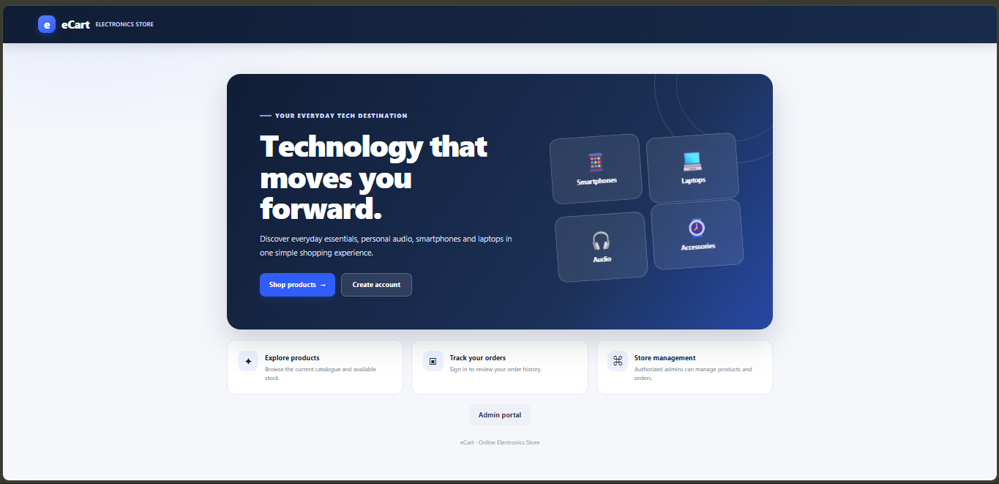
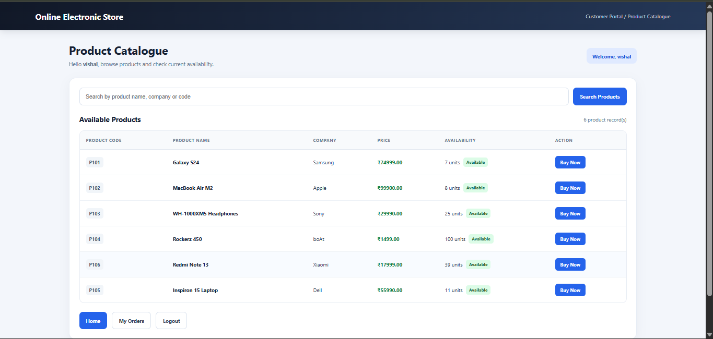
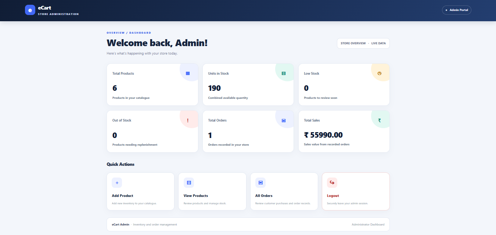

# eCart - Online Electronic Store

A full-stack e-commerce web application with separate admin and customer modules, built with Java, JSP and Servlets.

## Live Demo
https://ecart-yq5q.onrender.com

Note: this runs on a free server that sleeps when idle, so the first load can take up to a minute.
Demo admin login is available on request.

## Features

### Admin
- Secure login
- Add, view, edit and delete products
- View all customer orders

### Customer
- Register and login (passwords stored as hashes)
- Browse products
- Buy products (stock updates automatically)
- View own orders
- Change password

## Tech Stack
- Backend: Java, Servlets, JSP, JDBC
- Database: Oracle (local), PostgreSQL on Neon (live)
- Server: Apache Tomcat 9
- Deployment: Docker, Render
- Version control: Git, GitHub

## Screenshots

## How it works
Browser -> Servlets (controller) -> DAO classes (JDBC) -> Database
JSP pages render the views, and database settings are read from environment variables, so no passwords are stored in the code.

## Run locally
1. Install JDK, Tomcat 9 and a database (Oracle or PostgreSQL).
2. Create the tables: PRODUCT, CUSTOMER, ADMIN, ORDERS.
3. Set the environment variables DB_URL, DB_USER and DB_PASSWORD (and DB_DRIVER for PostgreSQL).
4. Deploy ecart.war to Tomcat's webapps folder and open http://localhost:8080/

## Author
Vishal More - B.C.S. student
GitHub: https://github.com/vishalmore-28
